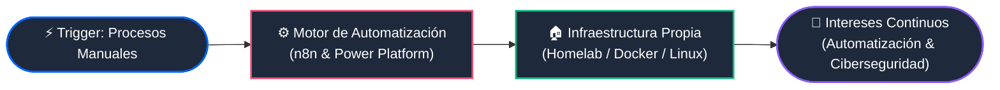

<div align="center">

  <!-- Banner Superior Estilo Pipeline / Automatización -->
  

  <!-- Simulador de Logs de Flujo de Trabajo -->
  <a href="https://github.com/mate58">
    +Starting+n8n+workflow...;%5BPROCESS%5D+Connecting+Microsoft+Power+Platform+pipelines...;%5BSERVER%5D+Deploying+Docker+containers+in+local+Homelab...;%5BINTERESTS%5D+Process+Automation+%26+Cybersecurity+Exploration" alt="Workflow Logs" />
  </a>

  <br/>

  <!-- Nodos de Perfil -->
  
  
  
  

</div>

---

### 🔄 Arquitectura de mi Perfil (Workflow Diagram)



---

### 📄 Payload de Configuración // `mate58_workflow.json`

```json
{
  "user": "mate58",
  "status": "Active",
  "experience": {
    "core": "Automatización y Mejora de Procesos",
    "platforms": ["n8n", "Power Automate", "Power Apps", "Power BI"],
    "capabilities": ["Integración de APIs", "Web Scraping", "Orquestación de Datos", "Bots"]
  },
  "homelab_infrastructure": {
    "status": "Self-Hosted & Running",
    "stack": ["Docker", "Ubuntu Server", "Linux", "Nginx", "Cloudflare"]
  },
  "current_interests": [
    "Automatización de procesos e hiperautomatización",
    "Ciberseguridad, hardening de servidores y seguridad en redes"
  ]
}
```

---

### 🛠️ Nodos y Conectores (Tech Stack)

<div align="center">

  #### Ecosistema de Automatización & Negocio
  
  
  
  
  

  #### Homelab, Desarrollo & Despliegue
  <br/>
  

</div>

---

### 📊 Métricas de Ejecución (GitHub Analytics)

<div align="center">
  
</div>

<div align="center">
  
  
</div>

<!-- Banner Inferior -->

